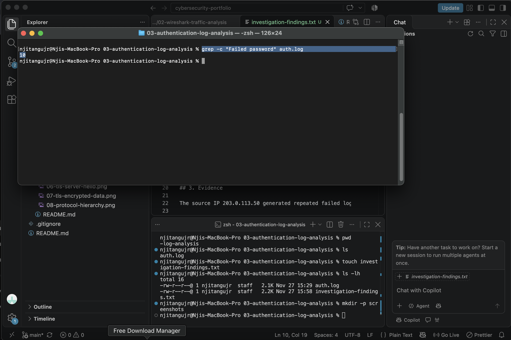
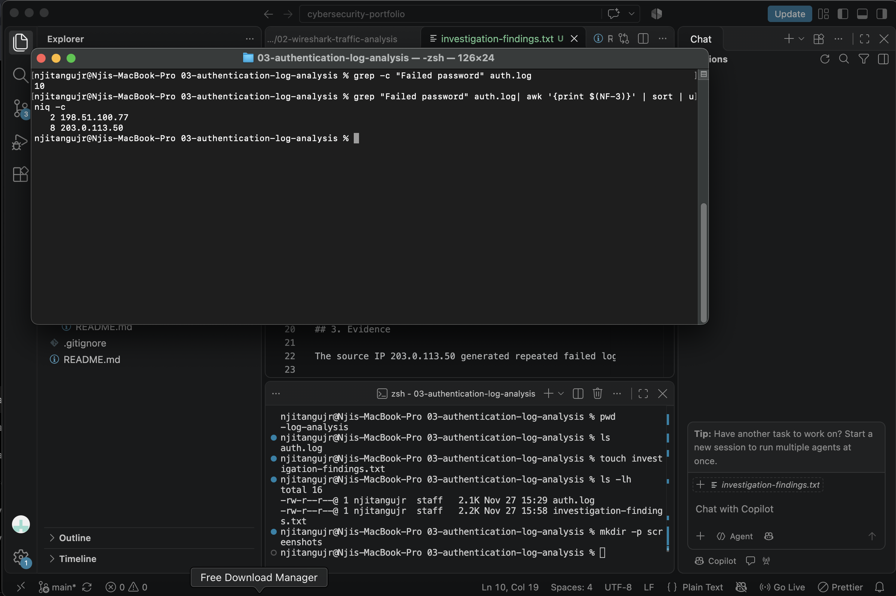
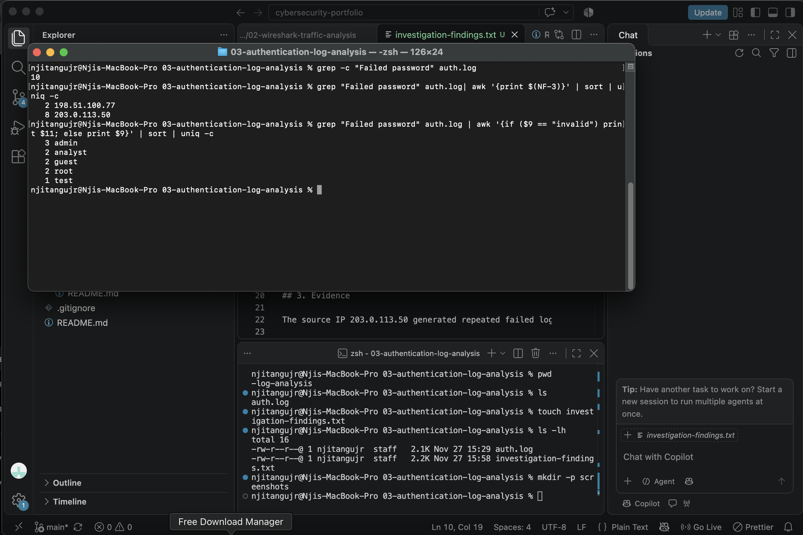
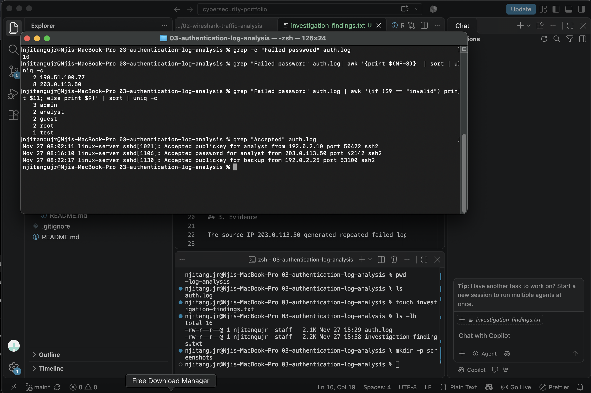
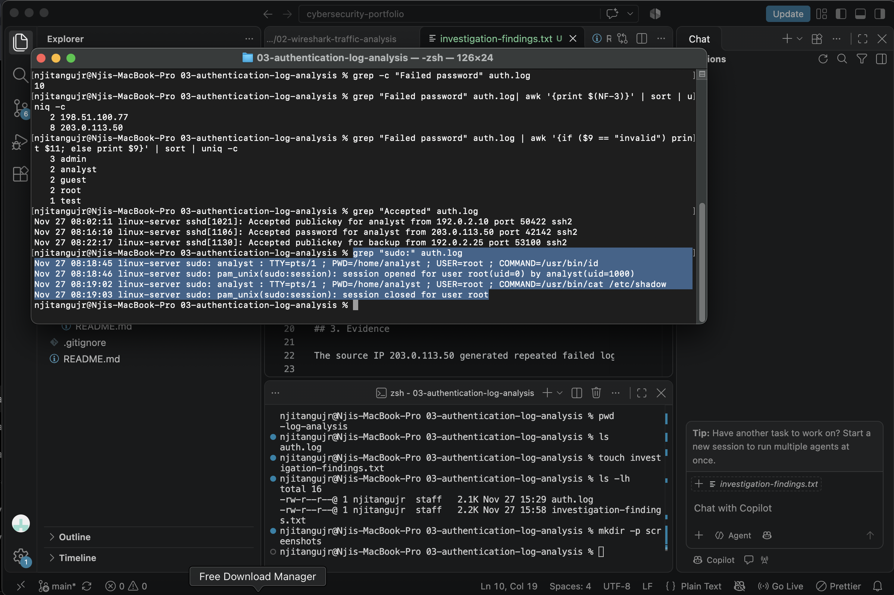
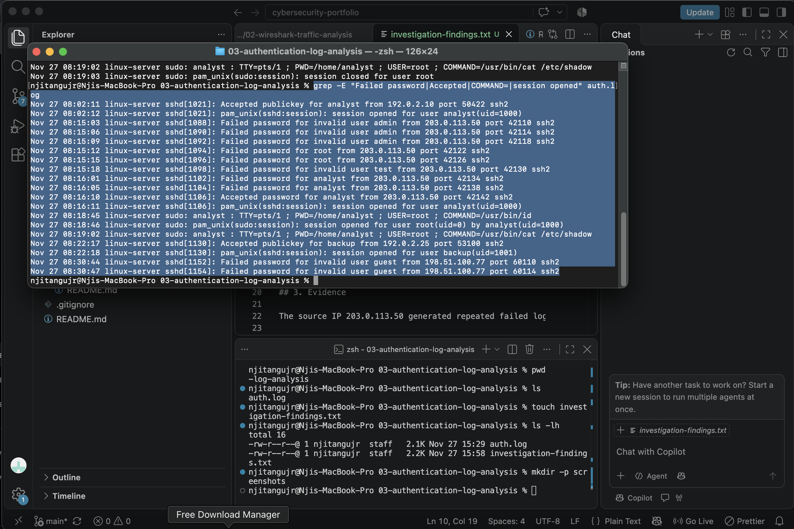

# Lab 03 – Linux Authentication Log Analysis

## 1. Overview

This lab demonstrates practical Linux authentication log analysis using command-line tools to investigate SSH login activity, identify suspicious authentication patterns, and examine privileged command execution.

The investigation uses a simulated Linux authentication log dataset containing normal and suspicious activity.

## 2. Objectives

- Identify failed SSH authentication attempts.
- Identify source IP addresses generating repeated failures.
- Determine which usernames were targeted.
- Identify successful SSH logins.
- Investigate privileged activity involving sudo.
- Build an incident timeline.
- Produce a preliminary SOC assessment.

## 3. Environment and Tools

| Component | Details |
|---|---|
| Analysis platform | macOS |
| Dataset | Simulated Linux auth.log |
| Shell | macOS Terminal |
| Tools | grep, awk, sort, uniq |
| Log format | Linux authentication log format |

**Note:** The dataset is simulated for educational purposes. The IP addresses belong to documentation-only ranges.

## 4. Investigation Methodology

### 4.1 Failed SSH Authentication

Command:

`grep -c "Failed password" auth.log`

Result: 10 failed authentication attempts.

### 4.2 Source IP Analysis

Command:

`grep "Failed password" auth.log | awk '{print $(NF-3)}' | sort | uniq -c`

Results:

| Source IP | Failed attempts |
|---|---:|
| 203.0.113.50 | 8 |
| 198.51.100.77 | 2 |

The address 203.0.113.50 generated the majority of failed authentication attempts and became the primary investigation target.

### 4.3 Targeted Username Analysis

Command:

`grep "Failed password" auth.log | awk '{if ($9 == "invalid") print $11; else print $9}' | sort | uniq -c`

Results:

| Username | Failed attempts |
|---|---:|
| admin | 3 |
| analyst | 2 |
| guest | 2 |
| root | 2 |
| test | 1 |

The activity shows attempts against multiple usernames, including privileged accounts.

### 4.4 Successful SSH Authentication

Command:

`grep "Accepted" auth.log`

Three successful SSH logins were identified:

| Time | User | Method | Source IP |
|---|---|---|---|
| 08:02:11 | analyst | Public key | 192.0.2.10 |
| 08:16:10 | analyst | Password | 203.0.113.50 |
| 08:22:17 | backup | Public key | 192.0.2.25 |

The successful password authentication from 203.0.113.50 is particularly suspicious because the same address generated eight failed attempts shortly beforehand.

### 4.5 Sudo Activity Analysis

Command:

`grep "sudo:" auth.log`

Important commands identified:

- `/usr/bin/id`
- `/usr/bin/cat /etc/shadow`

The attempt to read `/etc/shadow` is significant because the file contains sensitive password hash information.

### 4.6 Incident Timeline

Command:

`grep -E "Failed password|Accepted|COMMAND=|session opened" auth.log`

Key events:

| Time | Event |
|---|---|
| 08:15:03–08:15:18 | Multiple failed attempts against different usernames |
| 08:16:01–08:16:05 | Failed attempts against analyst |
| 08:16:10 | Successful password login for analyst |
| 08:16:11 | SSH session opened |
| 08:18:45 | analyst executed id using sudo |
| 08:18:46 | Root sudo session opened |
| 08:19:02 | Attempt to read /etc/shadow |

## 5. Key Findings

1. Ten failed SSH authentication attempts were identified.
2. 203.0.113.50 generated eight failed attempts.
3. Multiple usernames were targeted, including root and analyst.
4. A successful password login for analyst followed the failed attempts from the same source IP.
5. The analyst account subsequently executed privileged commands.
6. An attempt to read the sensitive /etc/shadow file was recorded.

## 6. Security Assessment

The observed sequence is consistent with possible password-guessing activity followed by successful account access and privileged investigation of the system.

The successful login from the same source IP following repeated failures, combined with subsequent sudo activity, warrants further investigation.

However, the available logs do not conclusively establish unauthorized access, credential compromise, or successful extraction of password hashes.

## 7. Recommended SOC Response

- Validate whether the login from 203.0.113.50 was authorized.
- Investigate the analyst account's authentication history.
- Review sudo permissions and privileged command execution.
- Examine relevant system and application logs for additional evidence.
- If compromise is confirmed, contain the affected account and investigate potential credential exposure.
- Preserve logs and document all investigative actions.

## 8. Skills Demonstrated

- Linux authentication log analysis.
- SSH authentication investigation.
- Failed login detection.
- Source IP extraction and frequency analysis.
- Username enumeration analysis.
- Successful login investigation.
- Sudo and privilege activity analysis.
- Incident timeline reconstruction.
- Preliminary SOC incident assessment.

## 9. Conclusion

This lab demonstrates how authentication logs can be used to identify suspicious login patterns and investigate potential account compromise.

It reinforces the importance of correlating failed authentication attempts, successful logins, session activity, and privileged command execution when investigating security events.

**Dataset classification:** Simulated training data. All IP addresses are reserved documentation addresses.