# Lab 01 — Network Reconnaissance on macOS

## Objective

The objective of this lab is to understand my local network configuration
and identify network interfaces, IP addresses, the default gateway,
DNS servers, and active network connections.

## Environment

- Operating System: macOS
- Platform: Mac
- Tools: Terminal, ifconfig, route, scutil, lsof, netstat

## Tasks

- [ ] Identify active network interfaces
- [ ] Identify local IP address
- [ ] Identify subnet mask
- [ ] Identify default gateway
- [ ] Identify DNS servers
- [ ] Test network connectivity
- [ ] Perform DNS lookups
- [ ] Identify listening ports
- [ ] Inspect established connections
- [ ] Analyze DNS traffic using Wireshark

## Commands Used

### 1. Identify active network interface

```bash
ifconfig 
```

This command displays the configuration and status of network interfaces on macOS, including interface names, IP addresses, subnet masks, MAC addresses, and interface status flags.


### 2. Identify local ip address

```bash
ipconfig getifaddr en0
```

This command retrieves the IPv4 address assigned to the en0 network interface, which is commonly the Wi-Fi interface on macOS.


### 3. Identify Subnet Mask

```bash
ifconfig en0
```

This command displays the configuration of the `en0` network interface, including its IPv4 address and subnet mask.

The subnet mask helps determine which IP addresses belong to the local network and which destinations require communication through a router.


### 4. Identify Default Gateway

```bash
route -n get default
```

This command displays the default route used by macOS to send traffic to destinations outside the local network.

The output identifies the default gateway and the network interface used to reach it.


### 5. Identify DNS Servers

```bash
scutil --dns
```

This command displays the DNS resolver configuration used by macOS, including configured DNS servers and resolver information.

To display DNS servers configured for the Wi-Fi network service, I also used:

```bash
networksetup -getdnsservers Wi-Fi
```

This command displays the DNS servers configured for the Wi-Fi network service.


### 6. Test Network Connectivity

#### Test connectivity to the default gateway

```bash
ping -c 4 <gateway-ip>
```

This command sends four ICMP Echo Requests to the default gateway to test connectivity between my Mac and the local router.

#### Test connectivity to an external IP address

```bash
ping -c 4 1.1.1.1
```

This command tests IP connectivity to an external destination without requiring DNS resolution.

#### Test connectivity using a domain name

```bash
ping -c 4 google.com
```

This command tests connectivity to a destination using its domain name and requires DNS resolution.


### 7. Perform DNS Lookups

#### Basic DNS lookup

```bash
nslookup google.com
```

This command queries the configured DNS server to resolve `google.com` into IP addresses.

#### Detailed DNS query

```bash
dig google.com
```

This command performs a DNS query and displays detailed information about the query and response.

#### Query IPv4 records

```bash
dig google.com A
```

This command requests the IPv4 address records associated with the domain.

#### Query IPv6 records

```bash
dig google.com AAAA
```

This command requests the IPv6 address records associated with the domain.

#### Query mail records

```bash
dig google.com MX
```

This command requests the mail exchange records associated with the domain.


### 8. Identify Listening Ports

```bash
sudo lsof -i -P -n | grep LISTEN
```

This command lists network-related processes and filters the output to show listening sockets.

The `-P` option displays numerical port numbers, while `-n` prevents hostname resolution. The `grep LISTEN` filter displays connections in the listening state.

Listening ports indicate services or processes waiting for incoming network connections.


### 9. Inspect Established Connections

```bash
sudo lsof -i -P -n | grep ESTABLISHED
```

This command lists network connections and filters the results to show connections in the `ESTABLISHED` state.

An established connection indicates that a TCP connection has successfully completed the connection establishment process and is currently active.

An alternative command is:

```bash
netstat -an | grep ESTABLISHED
```

This command displays network connection information and filters the output for established connections.


### 10. Analyze DNS Traffic Using Wireshark

#### Objective

The objective of this exercise is to capture and inspect DNS traffic to understand how DNS queries and responses are transmitted across the network.

#### Procedure

1. Installed and launched Wireshark.
2. Selected the active network interface, commonly `en0`.
3. Started a packet capture.
4. Generated DNS traffic using the following command:

```bash
dig example.com
```

5. Stopped the packet capture.
6. Applied the following display filter:

```text
dns
```

7. Selected DNS packets and inspected the packet details.

#### DNS Display Filters

```text
dns
```

Displays DNS traffic.

```text
dns.qry.name == "example.com"
```

Displays DNS queries for `example.com`.

#### Analysis

During the packet analysis, I examined the DNS query and response, including the source and destination addresses, queried domain name, query type, and returned DNS information.


## Evidence

### 1. Network Interface Identification

The screenshot below shows the output of `ifconfig`, which I used to examine the network interfaces available on my system and identified their configuration details.


### 2. Local IP Address

The screenshot below shows the output of the command used to retrieve the IPv4 address assigned to the `en0` network interface.

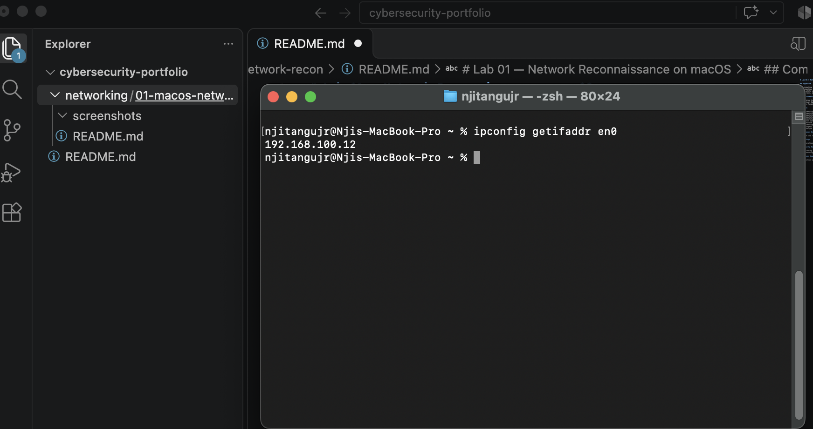


### 3. Subnet Mask Identification

The screenshot below shows the network interface configuration, including the IPv4 address and subnet mask assigned to `en0`.

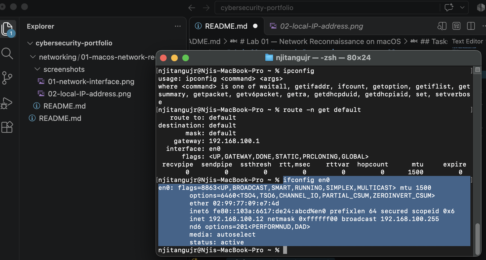


### 4. Default Gateway Identification

The screenshot below shows the default routing information obtained using the `route` command.

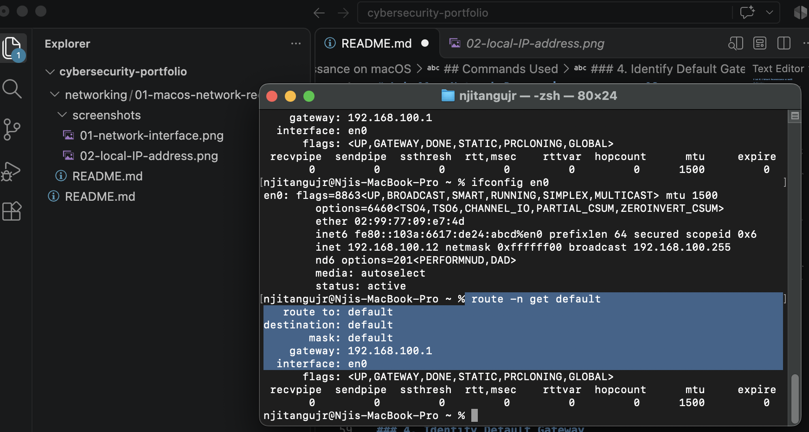


### 5. DNS Server Identification

The screenshots below show the DNS resolver configuration and the DNS servers configured for the Wi-Fi network service.

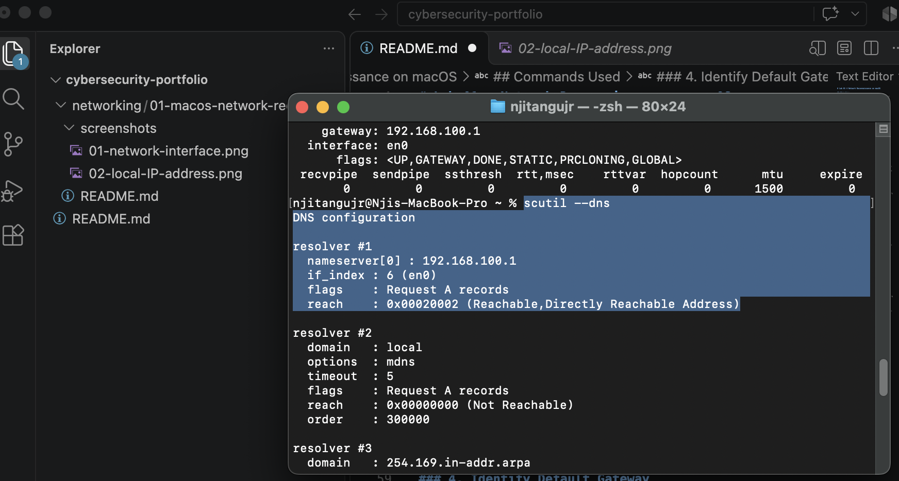


### 6. Network Connectivity Testing

The screenshots below show the results of connectivity tests to the default gateway, an external IP address, and a domain name.

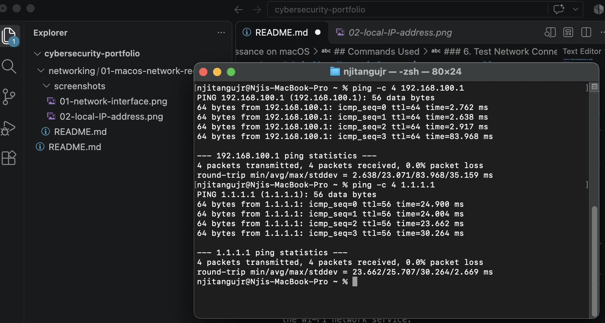


### 7. DNS Lookup Results

The screenshots below show the DNS lookup results obtained using `nslookup` and `dig`.

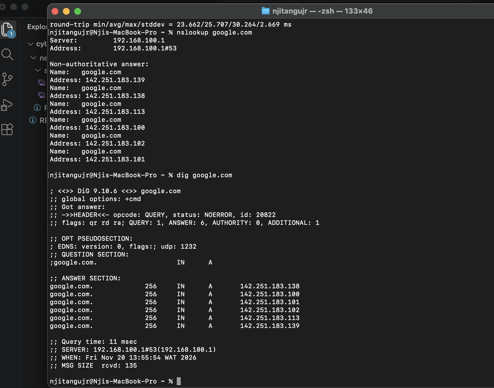 
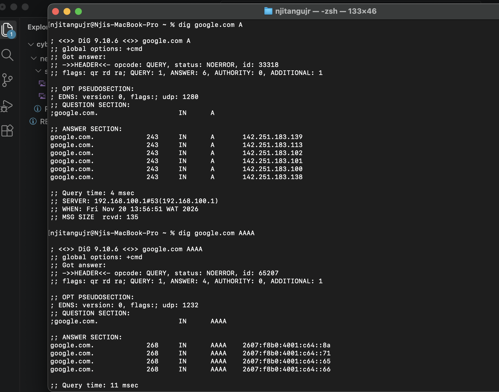
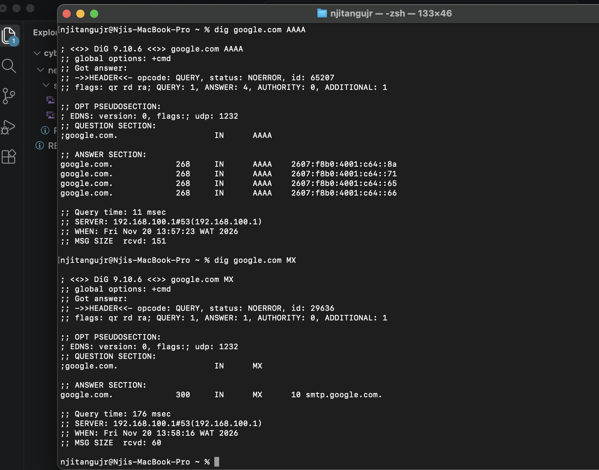

### 8. Listening Port Identification

The screenshot below shows the listening network ports and the processes associated with them.

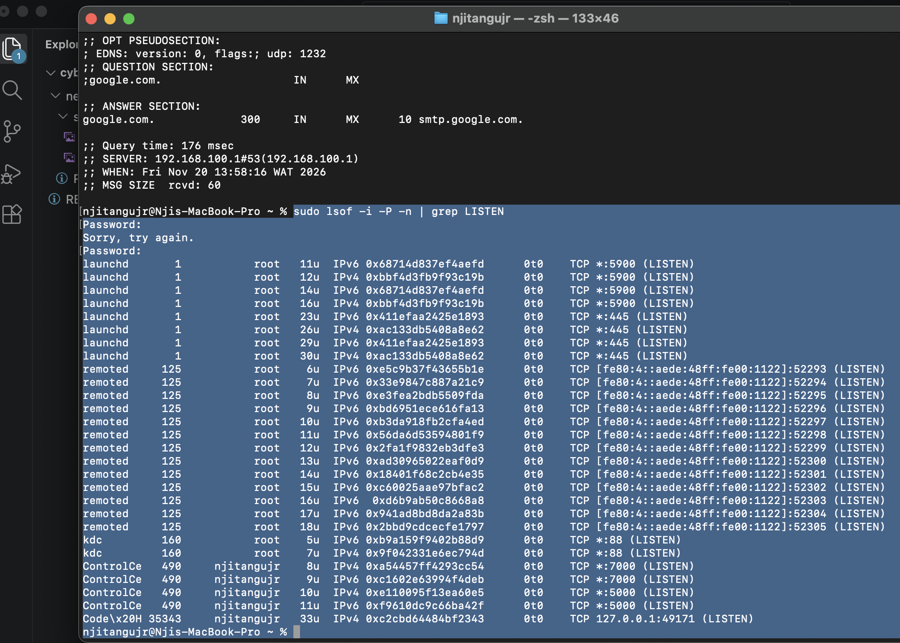


### 9. Established Network Connections

The screenshot below shows active network connections in the established state.

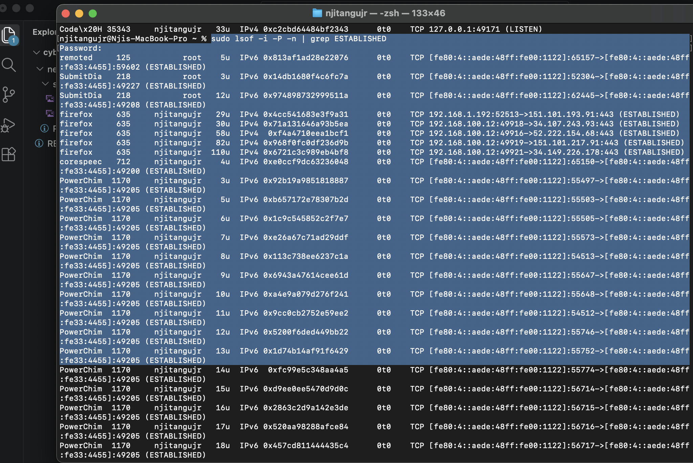
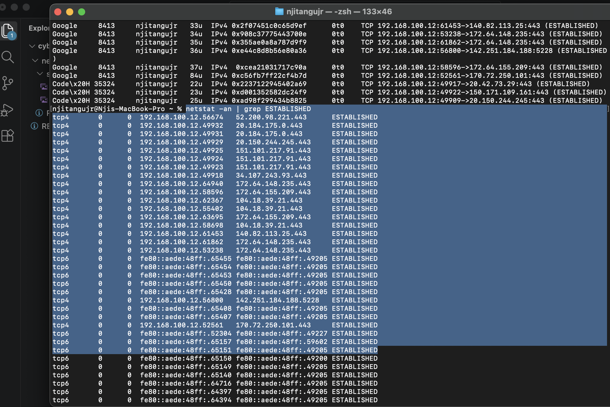


### 10. DNS Packet Analysis

The screenshot below shows the DNS packets captured in Wireshark and the packet details inspected during the analysis.

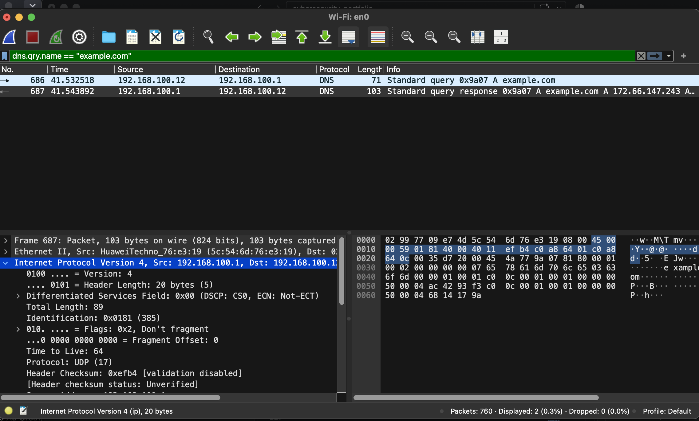
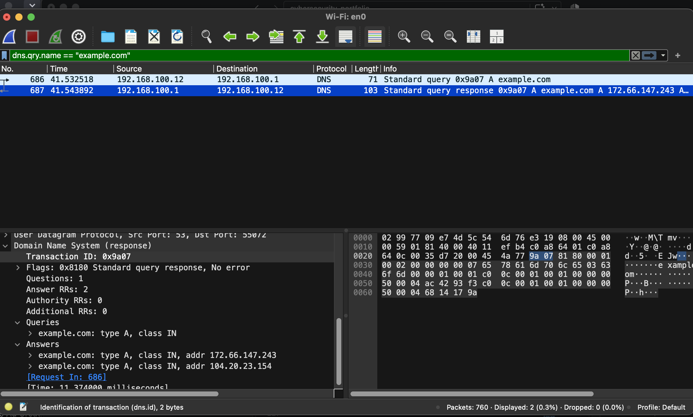

## Findings

### Network Configuration
- Active network interface: en0
- Local IPv4 address: 192.168.100.12
- Subnet mask: 0xffffff00 (255.255.255.0 or /24)
- Default gateway: 192.168.100.1
- DNS server(s):
resolver #1
  nameserver[0] : 192.168.100.1
  if_index : 6 (en0)
  flags    : Request A records
  reach    : 0x00020002 (Reachable,Directly Reachable Address)


### Connectivity
- Gateway connectivity: 4 packets transmitted,
4 packets received, 0.0% packet loss
- External IP connectivity: --- 1.1.1.1 ping statistics --- 4 packets transmitted, 4 packets received, 0.0% packet loss round-trip min/avg/max stddev = 23.662/25.707/30.264/2.669 ms
- Domain name connectivity: --- google.com ping statistics --- 4 packets transmitted, 4 packets received, 0.0% packet loss round-trip min/avg/max/stddev = 199.183/225.995/275.563/30.067 ms

### DNS
- DNS resolution successful: Yes
- IPv4 records observed:
google.com.		256	IN	A	142.251.183.138
google.com.		256	IN	A	142.251.183.100
google.com.		256	IN	A	142.251.183.101
google.com.		256	IN	A	142.251.183.102
google.com.		256	IN	A	142.251.183.113
google.com.		256	IN	A	142.251.183.139
- IPv6 records observed:
google.com.		268	IN	AAAA	2607:f8b0:4001:c64::8a
google.com.		268	IN	AAAA	2607:f8b0:4001:c64::71
google.com.		268	IN	AAAA	2607:f8b0:4001:c64::65
google.com.		268	IN	AAAA	2607:f8b0:4001:c64::66
- MX records observed:
google.com.		300	IN	MX	10 smtp.google.com.

### Network Services
- Listening ports observed:
5900 
445 
52293 
52294 
52295 
52296 
52297 
52298
52299 
52300 
52301
52302
52303 
52304
52305
88 
7000
5000
49171

- Processes associated with listening ports:
launchd
remoted
kdc
controlCe

### Active Connections
- Established connections observed: Multiple established network connections were observed.
- Processes associated with connections:
remoted     125           root    5u  IPv6 0x813af1ad28e22076      0t0    TCP [fe80:4::aede:48ff:fe00:1122]:65157->[fe80:4::aede:48ff:fe33:4455]:59602 (ESTABLISHED)
SubmitDia   218           root    3u  IPv6 0x14db1680f4c6fc7a      0t0    TCP [fe80:4::aede:48ff:fe00:1122]:52304->[fe80:4::aede:48ff:fe33:4455]:49227 (ESTABLISHED)
SubmitDia   218           root   12u  IPv6 0x974898732999511a      0t0    TCP [fe80:4::aede:48ff:fe00:1122]:62445->[fe80:4::aede:48ff:fe33:4455]:49208 (ESTABLISHED)
firefox     635     njitangujr   29u  IPv4 0x4cc541683e3f9a31      0t0    TCP 192.168.1.192:52513->151.101.193.91:443 (ESTABLISHED)


### Wireshark
- DNS queries captured: DNS queries and responses were observed during the capture.
- DNS query names observed: example.com
- DNS query types observed: A
- DNS responses observed: A DNS response containing the resolved address was observed.


## Lessons Learned

During this lab, I learned how to examine network interfaces and identify
my system's IP address, subnet mask, default gateway, and DNS configuration
using macOS command-line tools.

I practiced testing network connectivity using ping, performing DNS
queries using nslookup and dig, identifying listening ports and
established connections using lsof and netstat, and capturing DNS traffic
using Wireshark.

The lab helped me understand how these tools can be used to establish a
network baseline and support troubleshooting and security investigations.

