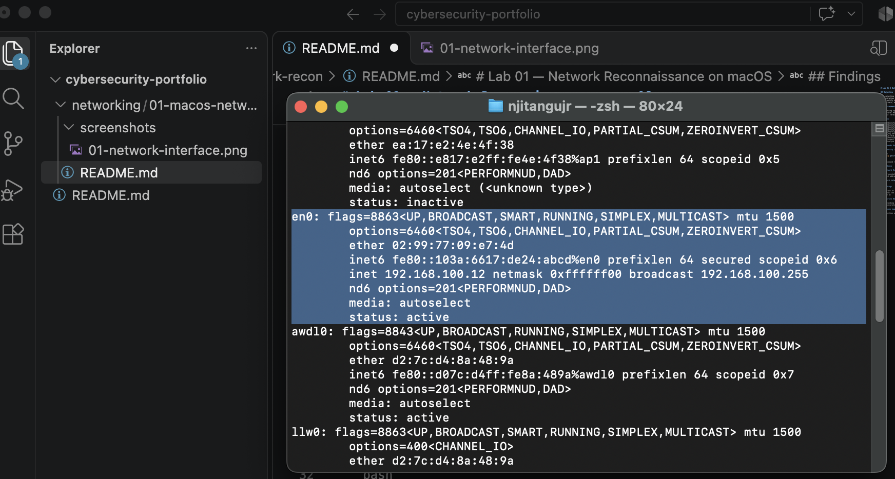

# Lab 01 — Network Reconnaissance on macOS

## Objective

The objective of this lab is to understand my local network configuration
and identify network interfaces, IP addresses, the default gateway,
DNS servers, and active network connections.

## Environment

- Operating System: macOS
- Platform: Mac
- Tools: Terminal, ifconfig, route, scutil, lsof, netstat

## Tasks

- [ ] Identify active network interfaces
- [ ] Identify local IP address
- [ ] Identify subnet mask
- [ ] Identify default gateway
- [ ] Identify DNS servers
- [ ] Test network connectivity
- [ ] Perform DNS lookups
- [ ] Identify listening ports
- [ ] Inspect established connections
- [ ] Analyze DNS traffic using Wireshark

## Commands Used

## Identify

### Identify active network interface

```bash
ipconfig 
```

This command retrieves the IPv4 address assigned to the en0 interface.

## Evidence

### Network Interface Identification

The screenshot below shows the output of the command used to retrieve the IPv4 address assigned to the en0 network interface.



## Findings

The output of the command reveals the private ip of the local network.
It allows the router and other devices on the network to communicate with my pc

## Security Relevance

Understanding normal network configuration and network activity
helps security analysts establish baselines and investigate anomalies.

## Lessons Learned

This section will summarize what I learned during the lab.


